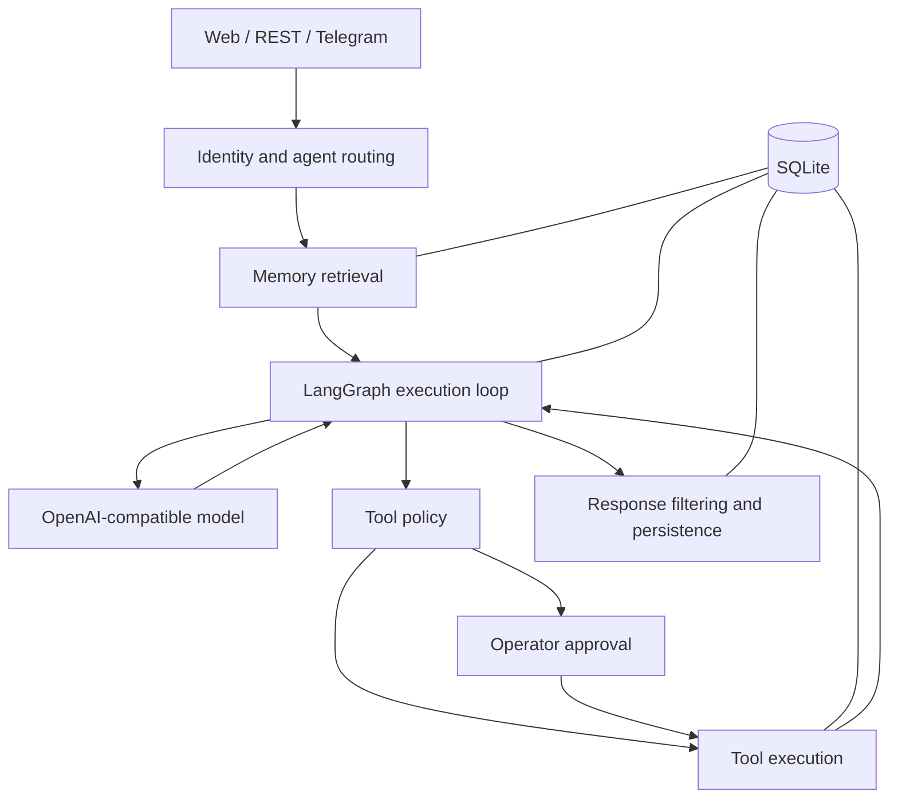

# Poseidon

**A personal AI assistant with persistent memory, controlled tool execution, and a web interface for inspecting every run.**

Poseidon connects conversational AI to notes, contacts, calendar records, and reusable task instructions. It retrieves context from previous conversations, evaluates tool calls against an explicit policy, and pauses sensitive actions for approval. A React dashboard exposes the assistant's memory, pending approvals, and execution history.

Built with **Python, FastAPI, LangGraph, SQLite, React, and Vite**. Supports OpenAI-compatible model endpoints and an optional Telegram interface.

## Capabilities

- **Persistent context:** conversation retrieval through embeddings, searchable facts through SQLite FTS5, and file-based procedural skills.
- **Personal tools:** search and manage notes, reminders, contacts, and local calendar events.
- **Approval workflow:** review sensitive actions before execution, with SQLite-backed graph checkpoints and approval records.
- **Agent configuration:** define personas, tool permissions, routing signals, and per-agent model settings.
- **Execution visibility:** inspect trajectories, memory, audit events, and model configuration in the web interface.
- **Multiple interfaces:** interact through the browser, REST API, or Telegram, with durable receipt tracking for Telegram updates.

## Architecture



FastAPI handles incoming requests and resolves the caller's identity. The orchestration layer selects an agent, retrieves relevant memory, and runs a bounded model/tool loop. A shared policy service checks tool availability, argument shape, agent permissions, execution limits, and context risk before dispatching a handler.

LangGraph checkpoints and approval records preserve execution state across restarts. The execution ledger records tool outcomes and avoids automatically repeating calls whose earlier outcome is uncertain. Audit events and trajectories make the flow inspectable from the dashboard.

### Memory

| Layer | Implementation | Role |
| --- | --- | --- |
| Working | In-process session context | Recent conversation messages |
| Episodic | SQLite with embeddings | Retrieve relevant past conversations |
| Semantic | SQLite FTS5 and BM25 ranking | Retrieve stored facts and preferences |
| Procedural | `*.SKILL.md` files | Select reusable instructions by trigger |

Memory hydration assembles context before inference. Completed turns are recorded as episodes; consolidation can extract durable facts into semantic memory. SQLite is the source of truth for episodic and semantic records, while a generated Markdown mirror supports manual inspection.

### Tool permissions

| Policy tier | Examples | Behavior |
| --- | --- | --- |
| `auto` | Read contacts, notes, calendar events, or skills | Execute when policy checks pass |
| `guarded_auto` | Create notes and reminders | Inspect content; suspicious requests require approval |
| `approval_required` | Modify contacts, delete notes, create calendar events or skills | Pause for operator approval |

Notes, contacts, and calendar records use transactional, owner-scoped SQLite repositories. Calendar events are local to Poseidon; external calendar integration is outside the current scope.

## Run locally

Requirements: **Python 3.11+**, **Node.js 20.19+ within the 20.x line or 22.12+**, and **npm**. SQLite must support FTS5, JSON functions, and WAL. Startup checks report database capabilities; vector retrieval falls back to Python cosine similarity when the SQLite vector extension is unavailable.

The commands below use PowerShell and start from the repository root.

### 1. Configure a model

```powershell
Copy-Item .env.example .env
```

Edit `.env` with your endpoint, model, and credentials. For a local Ollama endpoint with `llama3.2` already installed:

```dotenv
POSEIDON_BASE_URL=http://localhost:11434/v1
POSEIDON_MODEL=llama3.2
POSEIDON_API_KEY=ollama
```

For a cloud provider, supply its OpenAI-compatible base URL, model identifier, and API key. The Settings view supports per-agent provider overrides; check it if an agent uses a different model from the environment configuration.

Keep credentials in `.env` or environment variables. Cloud inference sends model inputs to the configured provider. Embeddings may require a model download on first use.

### 2. Start the backend

```powershell
python -m venv .venv
.\.venv\Scripts\Activate.ps1
python -m pip install -r requirements.txt
python -m uvicorn app.main:app --app-dir backend --env-file .env --reload --host 127.0.0.1 --port 8000
```

The explicit `--env-file .env` loads the configuration copied in step 1. Check the service at `http://127.0.0.1:8000/health`; interactive API documentation is available at `http://127.0.0.1:8000/docs`.

### 3. Start the web interface

In a second terminal, from the repository root:

```powershell
Set-Location frontend
npm ci
npm run dev
```

Open `http://localhost:5173`. Vite proxies API requests to the backend on port `8000`.

### Optional: Telegram

Set `TELEGRAM_BOT_TOKEN`, `TELEGRAM_ALLOWED_USER_IDS`, and `TELEGRAM_POLLING_ENABLED=true` in `.env`, then restart the backend. Allowed user IDs are comma-separated; an empty allowlist rejects all senders. A webhook adapter is also available, with an optional `TELEGRAM_WEBHOOK_SECRET` check.

## Configuration

| Variable | Purpose |
| --- | --- |
| `POSEIDON_BASE_URL`, `POSEIDON_MODEL`, `POSEIDON_API_KEY` | Default inference endpoint and credentials |
| `POSEIDON_MAX_ITERATIONS`, `POSEIDON_MAX_TOOL_CALLS` | Per-turn execution limits; both default to `5` |
| `POSEIDON_DB_PATH` | SQLite database location |
| `POSEIDON_CHECKPOINT_DB_PATH` | LangGraph checkpoint database; defaults beside `POSEIDON_DB_PATH` |
| `AGENTS_DIR`, `LLM_CONFIG_PATH` | Agent definitions and persisted model overrides |
| `POSEIDON_CONSOLIDATION_THRESHOLD` | Threshold for automatic memory consolidation; defaults to `30` |
| `POSEIDON_EMBEDDING_MODEL`, `POSEIDON_EMBEDDING_DIM` | Embedding model and matching vector dimension |
| `POSEIDON_API_TOKEN` | Bearer token required for remote operator requests |
| `POSEIDON_CORS_ORIGINS` | Explicit allowed origins, supplied as a JSON array |

See [.env.example](.env.example) for additional options and [config.py](backend/app/config.py) for defaults. Restart the backend after changing environment configuration.

## Repository structure

```text
backend/
  app/
    agents/          Conversational and summarizer agents
    db/              SQLite connections and migrations
    gateway/         REST and Telegram adapters
    memory/          Retrieval, storage, and consolidation
    orchestration/   Execution graph, checkpoints, and approvals
    security/        Identity, redaction, risk checks, and auditing
    tools/           Tool registry, policy, and personal data repositories
  scripts/           Integration and release checks
  tests/             Backend test suite
frontend/
  src/               React interface and frontend tests
memory-store/        Agent and skill files; local runtime data
```

Runtime locations are configurable. The current settings default the database, agent directory, and model configuration to the repository's `memory-store/`; use `POSEIDON_DB_PATH`, `AGENTS_DIR`, and `LLM_CONFIG_PATH` to select another location. Browser chat history is stored separately in `localStorage`.

LangGraph checkpoints use `memory-store/checkpoints.db` by default. On first startup after this change, Poseidon copies existing checkpoints from `state.db` if the new checkpoint database is empty.

## Validation

Run backend tests from the repository root with the virtual environment active:

```powershell
python -m pytest backend\tests -q
```

Run frontend checks from `frontend/`:

```powershell
npm run lint
npm test
npm run build
```

The combined release check runs integration scenarios, backend tests, and frontend lint/tests with isolated storage and verifies that repository `memory-store/` files remain unchanged:

```powershell
python backend\scripts\run_gate.py
```

## Scope and constraints

Poseidon is designed for a personal, local deployment. Remote operator requests require a bearer token, and non-loopback configuration requires explicit CORS origins. These controls do not constitute a full multi-user account system.

Tool handlers run in process with validation and timeouts. Pattern-based redaction and prompt-risk checks provide additional safeguards, but do not guarantee detection of every secret or malicious instruction. External MCP server discovery and lifecycle management remain incomplete. Telegram updates are durably deduplicated, while failed updates require manual recovery rather than automatic retry.
