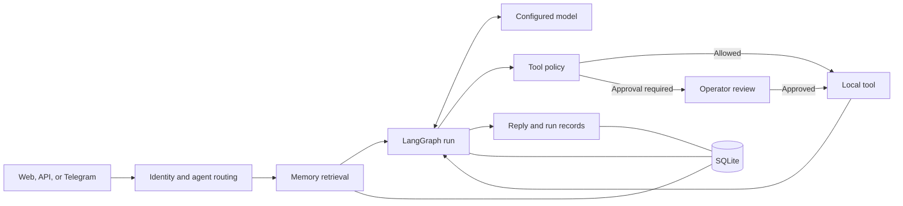

# Poseidon

Poseidon is a local-first personal AI assistant built to do more than answer questions. It keeps useful context across conversations, can work with local notes, reminders, contacts, and calendar records, and asks for approval before sensitive changes. A React interface exposes conversations, agents, memory, and run history.

The backend uses FastAPI, LangGraph, and SQLite. The frontend uses React and Vite. Inference runs through a configurable OpenAI-compatible endpoint, including a local Ollama server.

## What works today

- **Conversation and memory.** Recent turns, retrieved episodes, stored facts, and procedural skill files provide context for replies. Episodes and facts are stored in SQLite; semantic search uses FTS5, and episodic retrieval uses embeddings.
- **Tool use with review.** The agent can read local notes, reminders, contacts, and calendar events. Creating or deleting some records requires operator approval. Tool policy checks arguments, permissions, risk, and per-turn limits before execution.
- **Durable runs.** LangGraph checkpoints and SQLite approval records allow paused work to resume after a restart. Trajectories and audit events show what happened during a run.
- **Agent configuration.** Agent definitions include personas, allowed tools, routing signals, and model settings. The web interface includes an Agents view.
- **Brain.** A local Obsidian-compatible vault stores raw Markdown or text notes and generated topic pages. Poseidon can scan sources, show a source-to-topic graph, answer questions with source excerpts, and check for stale or broken links.
- **Telegram.** An allowlisted bot can handle conversations and Brain commands through polling or a webhook. Update receipts support retries and duplicate detection.

Poseidon runs as a personal deployment. The calendar is a **local record store**; Google Calendar, Meet, WhatsApp, coding sandboxes, and external coding agents are not integrated.

## How a request moves through the system



The runtime has explicit limits on model iterations and tool calls. Approval and checkpoint state live in SQLite. Browser chat history is stored separately in `localStorage`.

| Memory layer | Storage | Use |
| --- | --- | --- |
| Working | Current session | Recent messages |
| Episodic | SQLite and embeddings | Relevant past conversations |
| Semantic | SQLite FTS5 | Facts and preferences |
| Procedural | `*.SKILL.md` files | Reusable instructions |

Brain is a separate, source-backed knowledge view. It scans `.md` and `.txt` files, embeds short passages locally, and combines vector similarity with SQLite FTS5 search. Answers use retrieved passages with source citations. Brain checks for changed notes before answering. It does not parse PDFs.

## Run locally

Requirements: Python 3.11+, Node.js 20.19+ (20.x) or 22.12+, npm, and internet access for initial setup. From PowerShell in the repository root, run `powershell -ExecutionPolicy Bypass -File .\setup.ps1` once. It installs Python and frontend dependencies, downloads the shared embedding model, checks it works offline, and creates `.env` if missing. Subsequent starts use the saved model without internet. The script reuses an existing `.venv` or `venv` environment and leaves an existing `.env` untouched.

1. Copy the example environment file and configure a model:

   ```powershell
   Copy-Item .env.example .env
   ```

   The example configuration uses a hosted NVIDIA endpoint and requires `NVIDIA_API_KEY`. For a local Ollama model that you have already pulled, set these values in `.env`:

   ```dotenv
   POSEIDON_BASE_URL=http://localhost:11434/v1
   POSEIDON_MODEL=llama3.2
   POSEIDON_API_KEY=ollama
   ```

2. Start the backend using the environment reported by setup (`.venv` in this example):

   ```powershell
   .\.venv\Scripts\python.exe -m uvicorn app.main:app --app-dir backend --env-file .env --reload --host 127.0.0.1 --port 8000
   ```

   Check `http://127.0.0.1:8000/health`. FastAPI documentation is at `http://127.0.0.1:8000/docs`.

3. In a second terminal, start the frontend:

   ```powershell
   Set-Location frontend
   npm run dev
   ```

   Open `http://localhost:5173`. Vite proxies API requests to port 8000.

### Brain and Obsidian

The backend creates `memory-store/brain/raw` and `memory-store/brain/wiki` on first start. Open `memory-store/brain` as an Obsidian vault, add `.md` or `.txt` files to `raw/`, then use **Scan raw sources** in the Brain view. Poseidon writes topic pages to `wiki/` and leaves source files intact. Vault contents are ignored by Git.

For a populated example graph, run `venv\Scripts\python.exe backend/scripts/seed_demo_brain.py` from the repository root, then scan raw sources. The [fictional demo notes](backend/examples/brain/README.md) are kept in the repo; the command copies only missing notes into the local vault.

The Brain view also accepts pasted sources, answers questions from matching evidence, and reports missing or changed sources. By default, Brain model operations require a local model. Set `POSEIDON_BRAIN_ALLOW_REMOTE_MODEL=true` only if you want to send vault text to the configured remote provider. Use `POSEIDON_BRAIN_VAULT_PATH` to point at a different local vault.

Brain answers use retrieval-augmented generation: a local passage index finds relevant text, then the configured answer model receives those passages. Ask a question to refresh changed raw notes automatically; use **Scan raw sources** to update the graph without asking a question. Existing vaults get embeddings on the first scan or query after upgrading.

The default embedding model is `all-MiniLM-L6-v2` (384 dimensions). `setup.ps1` downloads and checks it during initial setup. Brain and episodic memory share one embedding implementation and one model instance per backend process. Normal use loads local files only and reports missing models; it never substitutes fake vectors. Facts continue to use SQLite FTS5 with BM25 ranking. Embedding inference stays local; the answer model follows the separate `POSEIDON_BRAIN_ALLOW_REMOTE_MODEL` setting. Changing `POSEIDON_EMBEDDING_MODEL` or `POSEIDON_EMBEDDING_DIM` rebuilds passage vectors on the next scan.

### Telegram

Set `TELEGRAM_BOT_TOKEN`, `TELEGRAM_ALLOWED_USER_IDS`, and `TELEGRAM_POLLING_ENABLED=true` in `.env`, then restart the backend. An empty allowlist denies all senders. Telegram supports `/brain add Title | source text`, `/brain ask question`, `/brain scan`, and `/brain lint`. Webhook use additionally requires `TELEGRAM_WEBHOOK_SECRET`.

## Repository map

```text
backend/app/
  agents/       Agent definitions, routing, and providers
  api/          HTTP endpoints
  brain/        Local source ingestion and topic wiki
  channels/     Telegram adapter
  memory/       Retrieval, storage, and consolidation
  runtime/      Conversation graph, checkpoints, and approvals
  security/     Identity, risk checks, redaction, and audit
  storage/      SQLite migrations and repositories
  tools/        Policy, execution, and built-in handlers
backend/tests/  Backend tests
frontend/src/   React application and frontend tests
memory-store/   Local agent files and runtime data
```

Runtime paths, model settings, limits, and channel options are documented in [.env.example](.env.example). Keep credentials in `.env` or environment variables; `.env` is not committed.

## Verify

From the repository root, with the Python environment active:

```powershell
python -m pytest backend\tests -q
```

From `frontend/`:

```powershell
npm run lint
npm test
npm run build
```

## Evaluations

The [evaluation runner](backend/evals/README.md) scores recorded responses with deterministic checks for answer content, citations, approvals, and agent routing. An optional LLM judge scores answer quality against reviewed references. The [wrong-citation demo](backend/evals/DEMO.md) shows a caught failure and judge decision. The bundled dataset is synthetic, and the [25-case review queue](backend/evals/REVIEW.md) still needs reviewed references and captured responses; neither is a measurement of Poseidon's accuracy on real user tasks.

## Current boundaries

Built-in tools run in the backend process with validation and timeouts. They are **not isolated sandboxes**. Registered MCP handlers remain unavailable for execution until an isolation boundary is added. The approval workflow, rate limits, redaction, and prompt-risk checks reduce risk but cannot guarantee that every unsafe input is detected. Remote operator access requires a bearer token and explicit CORS origins; Poseidon is not a multi-user account system.
